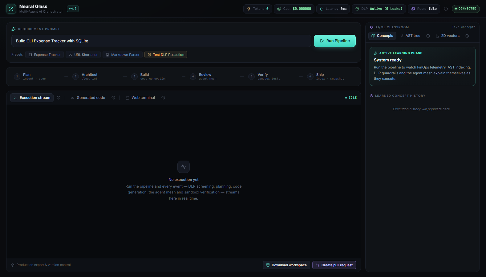
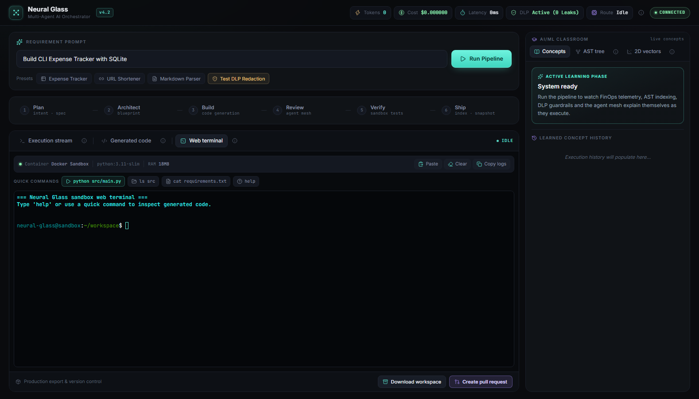
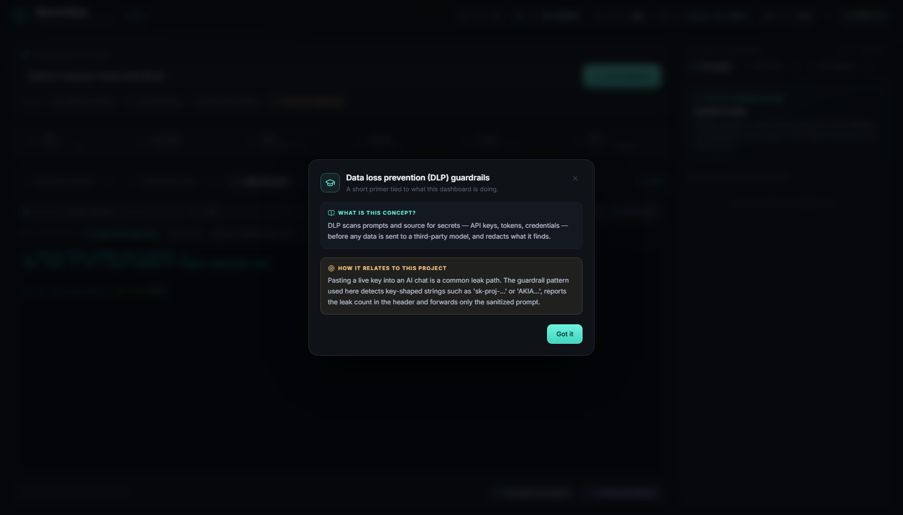
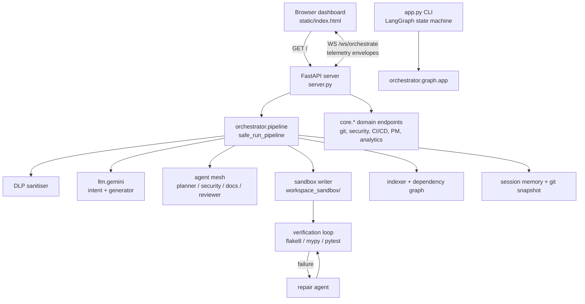

# Neural Glass — Multi-Agent AI Orchestrator

**An educational, runnable multi-agent engineering dashboard.** Describe a small
application in natural language, watch a LangGraph-style pipeline plan it, generate
the files with Gemini, gate persistence behind human approval, verify the result
with real linters/tests, and explain each concept as it happens.




---

## Contents

1. [Overview](#1-overview)
2. [Screenshots](#2-screenshots)
3. [Features](#3-features)
4. [Technology stack](#4-technology-stack)
5. [Architecture](#5-architecture)
6. [Pipeline stages](#6-pipeline-stages)
7. [Dashboard guide](#7-dashboard-guide)
8. [Project structure](#8-project-structure)
9. [Quick start](#9-quick-start)
10. [Configuration](#10-configuration)
11. [Telemetry protocol](#11-telemetry-protocol)
12. [API surface](#12-api-surface)
13. [Data loss prevention](#13-data-loss-prevention)
14. [FinOps telemetry](#14-finops-telemetry)
15. [Verification and sandbox](#15-verification-and-sandbox)
16. [Testing and validation](#16-testing-and-validation)
17. [Known limitations](#17-known-limitations)
18. [Troubleshooting](#18-troubleshooting)
19. [Roadmap](#19-roadmap)
20. [Contributing](#20-contributing)
21. [License](#21-license)

---

## 1. Overview

Neural Glass is a single-process FastAPI application with two faces:

* a **browser dashboard** (`static/index.html`) that streams orchestration
  telemetry over one WebSocket and teaches the underlying AI-engineering
  concepts in a side rail;
* a **backend** that turns a requirement into a small project on disk and then
  validates it with the real toolchain (`flake8`, `mypy`, `pytest`).

The runtime is **Gemini-only**. There is no multi-provider routing: every model
call goes through `llm/gemini.py`, and a deterministic local scaffold is used if
the model is unavailable. LangChain/LangGraph, the agent roles and the pipeline
structure are preserved from earlier versions of the project; this revision was
a documentation and presentation pass, not a re-architecture.

### What a run actually does

```text
prompt -> DLP screen -> Gemini intent -> planner agent -> Gemini code generation
       -> human approval gate -> write files -> security/doc/reviewer agents
       -> flake8 / mypy / pytest (up to 3 self-repairs) -> index -> git snapshot
       -> save session memory -> PIPELINE_COMPLETE
```

Everything is emitted to the browser as it happens, so the dashboard is a live
view of the pipeline rather than a progress bar over a black box.

---

## 2. Screenshots

All screenshots below were captured from the running application at
`http://127.0.0.1:8011/` with headless Chrome.

| Dashboard | Web terminal |
| --- | --- |
|  |  |

| Concept explainer modal |
| --- |
|  |

---

## 3. Features

**Orchestration**

* Sequential, observable pipeline with six UI stages mapped from real backend
  node events (`planner`, `architect`, `executor`, `agent_mesh`,
  `verification_runner`).
* Human-in-the-loop gate before files are persisted; approve/reject is accepted
  over the WebSocket or the REST endpoint.
* Parallel security / documentation / reviewer agents over the generated files.
* Verification loop that runs flake8, mypy and pytest and asks the repair agent
  to fix failures, with a bounded retry count.
* Session memory, plugin hooks and a git snapshot at the end of each run.

**Trust and cost visibility**

* DLP screening of the prompt with a live leak counter in the header.
* FinOps ledger: tokens, estimated USD cost, latency and active model route.
* Structured JSON logging, request-id tracing and metrics middleware.

**Dashboard**

* Single-page UI, no build step: Tailwind Play CDN, Lucide icons, xterm.js.
* Live execution stream, generated-file browser, in-browser terminal surface.
* Teaching rail with an AST view, a 2D embedding-similarity plot and concept
  history, plus an explainer modal behind every "i" button.
* Responsive layout down to tablet width, keyboard-friendly controls, ARIA
  roles on tabs and dialogs.

**Operations**

* Health, liveness and readiness probes.
* REST endpoints for git, security scanning, knowledge graph, CI/CD scaffolding,
  deployment targets, team presence and analytics.

---

## 4. Technology stack

| Layer | Choice | Notes |
| --- | --- | --- |
| Web framework | FastAPI + Uvicorn | Async routes, WebSocket, middleware |
| Validation / config | Pydantic + pydantic-settings | `.env` driven `Settings` |
| LLM | Google Gemini via `google-genai` | Only provider wired into the pipeline |
| Orchestration | LangGraph + LangChain core | `orchestrator/graph.py` state machine |
| Code intelligence | tree-sitter, Qdrant client, fastembed, rank-bm25 | Indexing/RAG helpers |
| Verification | flake8, mypy, pytest | Invoked as subprocesses |
| Frontend | Tailwind Play CDN, Lucide, xterm.js 5.3 + fit addon | No bundler, no npm |
| Logging / metrics | JSON logs, in-process metrics registry | Request-id propagation |
| Container execution | Kubernetes client with local fallback | Guarded imports |

Python 3.11 is the supported runtime; dependencies are pinned by category in
`requirements.txt`.

---

## 5. Architecture



Two entry points exist, deliberately:

* **`server.py`** — the web application and the pipeline the dashboard drives.
* **`app.py`** — an interactive CLI harness around the compiled LangGraph in
  `orchestrator/graph.py` (planner → scaffolder → executor → testers →
  exporter). It is useful for reading the state machine end to end, but it is
  not the process that serves the UI.

The detailed component map, data contracts and extension points live in
[`docs/ARCHITECTURE.md`](docs/ARCHITECTURE.md) and
[`docs/TECHNICAL_DOCUMENTATION.md`](docs/TECHNICAL_DOCUMENTATION.md).

---

## 6. Pipeline stages

`orchestrator/pipeline.py` numbers its stages in comments; this is what each one
does and what the UI shows.

| # | Stage | Implementation | Emitted event(s) |
| --- | --- | --- | --- |
| 0 | DLP screen | `orchestrator/dlp.py` | `DLP_REDACTION_WARNING` |
| 1 | Intent parsing | `call_gemini_intent` | `PIPELINE_INITIATED`, `NODE_ACTIVATED` (planner) |
| 2 | Planning | `run_planner_agent` | `CONCEPT_LEARNED`, `NODE_ACTIVATED` (architect) |
| 3 | Blueprint | planner output | `ARCHITECT_BLUEPRINT_CREATED` |
| 4 | Code generation | `call_gemini_generator` | `NODE_ACTIVATED` (executor) |
| 5 | Human approval | `wait_for_human_approval` | `HUMAN_APPROVAL_REQUESTED` |
| 6 | Persist files | `write_generated_files_to_sandbox` | `NODE_ACTIVATED` (agent_mesh) |
| 7 | Agent mesh | security, docs, reviewer | `AGENT_MESH_COMPLETED` |
| 8 | Verification | `orchestrator/testers.py` + `repair.py` | `VERIFICATION_SUITE_COMPLETED`, `SELF_REPAIR_TRIGGERED` |
| 9 | Indexing | `index_workspace`, `get_dependency_graph` | `CODEBASE_INDEXED` |
| 10 | AST telemetry | sample payload | `AST_INDEXED` |
| 11 | Vector telemetry | sample payload | `VECTORS_EMBEDDED` |
| 12 | Git snapshot | `generate_ai_commit` | `GIT_SNAPSHOT_CREATED` |
| 13 | Finish | memory, plugins | `PIPELINE_COMPLETE` |

> **Honest note.** Steps 10 and 11 (AST tree and vector plot) send fixed sample
> payloads so the teaching panel has something meaningful to render. They are
> not parsed/embedded from the generated files. Step 9 is the real indexing step.

The approval gate waits up to 300 seconds. Approving continues to persistence;
rejecting emits `PIPELINE_HALTED` and the run stops before anything is written.

---

## 7. Dashboard guide

**Header** — live tokens, estimated cost, latency, DLP status and active model
route, plus the WebSocket connection pill. The "i" button opens the DLP primer.

**Composer** — free-text requirement, four presets, and the Run button. Enter in
the input starts a run. The last preset intentionally contains a fake API key so
you can watch the DLP guardrail trigger.

**Pipeline stepper** — Plan → Architect → Build → Review → Verify → Ship. States
are driven by the events in the previous section: the active stage is mint, done
stages keep a filled dot, and a failure marks the running stage red.

**Workspace tabs**

| Tab | What it shows |
| --- | --- |
| Execution stream | One row per telemetry event, newest at the bottom, toned by severity |
| Generated code | File list produced by the run, with the source in the viewer |
| Web terminal | xterm.js surface with quick commands and paste/clear/copy |

**Teaching rail** — Concepts (current phase + history), AST tree (sample parse
tree or a node list) and 2D vectors (projection of embedding similarity). Every
info button explains the concept and how it applies here.

**Modals** — Human approval (payload preview + reviewer notes), GitHub pull
request form, and the educational explainer.

---

## 8. Project structure

```text
neural-glass/
├── server.py                  # FastAPI composition root, all REST routes + websocket
├── app.py                     # interactive CLI harness for the LangGraph state machine
├── requirements.txt
├── .env.example
├── static/
│   ├── index.html             # entire dashboard (markup + CSS + client logic)
│   └── favicon.svg
├── orchestrator/
│   ├── pipeline.py            # the 14-stage run used by the dashboard
│   ├── graph.py               # compiled LangGraph state machine (CLI path)
│   ├── state.py               # shared OrchestratorState TypedDict + factory
│   ├── agents.py              # planner / security / doc / reviewer agents
│   ├── testers.py             # flake8, mypy, pytest runners
│   ├── repair.py              # error classification + repair agent
│   ├── sandbox.py             # writes generated files into workspace_sandbox/
│   ├── indexer.py             # symbol indexing
│   ├── dep_graph.py           # dependency graph
│   ├── dlp.py                 # secret detection + redaction
│   ├── finops.py              # token/cost/latency ledger
│   ├── telemetry.py           # envelope helper
│   └── git_agent.py           # AI commit message
├── llm/
│   ├── gemini.py              # Gemini client + async adapter + fallback scaffold
│   └── retry.py               # retry decorator factory
├── websocket/manager.py       # connection registry + envelope emitter
├── core/                      # config, logging, metrics, tracing, health, domain engines
├── plugins/                   # plugin hooks loaded at runtime
├── workspace_sandbox/         # generated project output + git repo
├── tests/                     # empty; no automated suite yet
├── docs/
│   ├── ARCHITECTURE.md
│   ├── TECHNICAL_DOCUMENTATION.md
│   ├── API_DOCUMENTATION.md
│   ├── SETUP_GUIDE.md
│   ├── DEPLOYMENT.md
│   ├── README.md              # documentation index
│   └── assets/                # screenshots used in this README
└── local_orchestrator/        # earlier local variant kept for reference
```

---

## 9. Quick start

```bash
# 1. clone and enter the project
git clone https://github.com/Abbaskini01/multi-agent-ai-orchestrator.git
cd multi-agent-ai-orchestrator

# 2. create an environment
python -m venv venv
source venv/Scripts/activate      # Windows (Git Bash)
# source venv/bin/activate        # macOS / Linux

# 3. install dependencies
pip install -r requirements.txt

# 4. configure the one mandatory secret
cp .env.example .env
#    then set GEMINI_API_KEY in .env (never commit it)

# 5. run (uvicorn is the supported entry point)
python -m uvicorn server:app --host 127.0.0.1 --port 8000
```

Open <http://127.0.0.1:8000/>. Sanity check the backend:

```bash
curl http://127.0.0.1:8000/healthz
curl http://127.0.0.1:8000/api/plugins
```

The startup log prints `gemini_sdk_initialized` with the **length** of the key,
never the key itself. A missing key is not fatal: the pipeline then uses the
deterministic fallback scaffold.

Deeper instructions, including a Windows-specific walkthrough and offline mode,
are in [`docs/SETUP_GUIDE.md`](docs/SETUP_GUIDE.md).

> **Do not use `python server.py`.** Running the file as `__main__` breaks the
> deliberate `pipeline` ↔ `server` import cycle. Start it as the `server`
> module with uvicorn, exactly as above.

> **Before your first real run:** `workspace_sandbox/` contains tracked sample
> files that a run overwrites. Commit or copy anything you care about, or point
> `WORKSPACE_DIR` somewhere else.

---

## 10. Configuration

Settings are read from the environment or a root `.env` file by
`core/config.py` (`pydantic-settings`).

| Variable | Default | Purpose |
| --- | --- | --- |
| `GEMINI_API_KEY` | *(empty)* | Gemini credential; required for live generation |
| `DEFAULT_GEMINI_MODEL` | `gemini-3.8-flash` | Model id passed to every call |
| `APP_NAME` | `Neural Glass AI Orchestrator` | Title in OpenAPI and logs |
| `APP_VERSION` | `4.2.0` | Reported by health and root fallback |
| `APP_ENV` | `production` | `development` relaxes startup validation |
| `DEBUG` | `false` | Verbose error responses |
| `HOST` / `PORT` | `0.0.0.0` / `8000` | Server binding |
| `CORS_ORIGINS` | `["*"]` | JSON list of allowed origins |
| `LOG_LEVEL` | `INFO` | Root log level |
| `JSON_LOGGING` | `true` | Structured logs when true |
| `REQUEST_TIMEOUT_SECONDS` | `30` | Timeout applied to each model call |
| `MAX_API_RETRIES` | `3` | Retry attempts for model transport errors |
| `DLP_ENABLED` | `true` | Enable prompt secret screening |
| `SECRET_SCANNING_ENABLED` | `true` | Enable secret pattern scanning |
| `WORKSPACE_DIR` | `workspace_sandbox/` | Where generated projects are written |
| `WS_TIMEOUT_SECONDS` | `60` | WebSocket idle timeout |

`GROQ_API_KEY` / `DEFAULT_GROQ_MODEL` still exist in the settings model for
backwards compatibility but **nothing in the pipeline uses them**. Leaving them
unset is expected.

Telegram variables in `.env.example` are placeholders for the notifier agent and
are optional.

---

## 11. Telemetry protocol

One WebSocket endpoint carries a run: `ws://<host>/ws/orchestrate`.

**Client → server**

```json
{ "action": "START_PIPELINE", "prompt": "Build CLI Expense Tracker with SQLite" }
{ "action": "approve", "notes": "looks good" }
{ "action": "reject",  "notes": "unsafe file writes" }
```

The server reads `prompt`; `action` is accepted but optional for a start message.
`EXECUTE_COMMAND` is sent by the terminal panel but is **not handled** by the
server (see limitations).

**Server → client** — every message has the same envelope:

```json
{
  "type": "NODE_ACTIVATED",
  "event": "NODE_ACTIVATED",
  "data": { "node_id": "executor", "node_name": "Executor Agent", "phase": "Code Generation" },
  "title": "Active Concept Recorded",
  "description": "Learned about executor",
  "finops": { "total_tokens": 1840, "total_cost_usd": 0.000221, "latency_ms": 940, "model_route": "gemini-3.8-flash" }
}
```

The dashboard only relies on `event`, `data` and `finops`. `type` is retained for
older clients.

**Events the UI reacts to**

| Event | UI effect |
| --- | --- |
| `HUMAN_APPROVAL_REQUESTED` | Opens the approval modal with the payload preview |
| `DLP_REDACTION_WARNING` | Increments the leak counter, warns in the stream |
| `NODE_ACTIVATED` | Advances the stepper, updates the phase label |
| `CONCEPT_LEARNED` | Updates the concept card and appends history |
| `AST_INDEXED` | Renders the parse tree |
| `VECTORS_EMBEDDED` | Plots the embedding points |
| `CODEBASE_INDEXED` | Marks indexing complete (Ship stage) |
| `PIPELINE_COMPLETE` | Fills the file list, enables export, marks all stages done |
| `PIPELINE_HALTED` / `PIPELINE_ERROR` | Marks the running stage red, re-enables Run |

Anything else is still appended to the stream as a neutral row, so the log never
silently drops an event.

---

## 12. API surface

The live route table has **36 routes**. The complete, current reference — with
request bodies, response shapes and known gaps — is
[`docs/API_DOCUMENTATION.md`](docs/API_DOCUMENTATION.md). Summary:

| Group | Routes |
| --- | --- |
| System | `GET /`, `/healthz`, `/livez`, `/readyz` |
| Orchestration | `POST /api/execution/run`, `/approve`, `/reject`; `GET /reflection`, `/test-report`; `GET /api/agents/state` |
| Git | `GET /api/git/status`, `/diff`, `/commits`; `POST /api/git/rollback` |
| Code intelligence | `GET /api/codebase/graph`, `/symbols`, `/api/workspace/projects`, `/cross-graph` |
| Knowledge | `GET /api/knowledge/graph`, `/impact` |
| Security | `POST /api/security/scan`; `GET /api/security/compliance` |
| Delivery | `POST /api/cicd/generate`, `/deploy-verify`, `/deploy/canary`; `GET /api/deploy/targets` |
| IDE / team | `POST /api/ide/completion`; `GET /api/ide/diagnostics`; `GET /api/team/presence`; `POST /api/team/comment` |
| Platform | `GET /api/analytics/dashboard`, `/api/pm/milestones`, `/api/memory/history`, `/api/plugins`; `POST /api/pm/decompose`, `/api/k8s/execute` |
| Realtime | `WS /ws/orchestrate` |

FastAPI's generated schema is available at `/docs` while the server is running.

Two endpoints used by the dashboard do **not** exist on the backend:
`POST /api/export-zip` (download workspace) and `POST /api/create-pr` (create
pull request). The buttons are wired but will fail; see limitations.

---

## 13. Data loss prevention

Before the requirement reaches Gemini it passes through
`orchestrator/dlp.py`:

1. pattern matching for provider keys and tokens (`sk-…`, `AKIA…`, bearer
   tokens, password assignments);
2. the matched spans are replaced with a placeholder;
3. `DLP_REDACTION_WARNING` is emitted with the leak categories and the sanitized
   prompt, and the header counter increments.

The sanitized text — not the original — is what the planner and generator see.
This is a pragmatic regex guardrail for demonstration, not a certified DLP
product: pattern-based detection will miss unusual secret formats.

Try it with the **Test DLP Redaction** preset: the run proceeds with a redacted
prompt, and the header shows `Active (1 Blocked)`.

---

## 14. FinOps telemetry

`orchestrator/finops.py` accumulates per-step usage. Each telemetry envelope can
carry:

| Field | Meaning |
| --- | --- |
| `total_tokens` | Cumulative prompt + completion tokens for the run |
| `total_cost_usd` | Estimated spend from the configured per-token rates |
| `latency_ms` | Duration of the step that produced the event |
| `model_route` | Model id that served the call |

The dashboard mirrors these into the header on every event. The ledger is
in-process and resets when a new run starts; it is not persisted billing data.

---

## 15. Verification and sandbox

Generated files are written under `WORKSPACE_DIR` (default
`workspace_sandbox/`) by `orchestrator/sandbox.py`, which also initialises a git
repository used for the end-of-run snapshot.

The verification loop (`orchestrator/pipeline.py` step 6) runs, in order:

1. `flake8` — lint
2. `mypy` — type check
3. `pytest` — tests (the generated app may ship its own `tests/`)

On failure the traceback is classified by `orchestrator/repair.py`, the repair
agent is asked for corrected files, and the suite reruns. The loop is bounded
(3 attempts) so a bad generation cannot spin forever. Each attempt emits
`SELF_REPAIR_TRIGGERED`.

**What "sandbox" means here:** execution is a local subprocess inside the
workspace directory (with an optional Kubernetes path in `core/k8s_runner.py`
when a cluster is configured). It is not a hardened container boundary — do not
run untrusted prompts on a machine you care about.

---

## 16. Testing and validation

**There is no automated test suite.** The `tests/` directory is empty, and the
root-level `test_*.py` files are manual helper scripts (one of them sends a
Telegram message), not collected unit tests. `python -m pytest -q` currently
collects zero tests and exits successfully.

Checks performed for this documentation/UI revision:

| Check | Result |
| --- | --- |
| Server boot (`uvicorn server:app`, port 8011) | 200 on `/`, `/healthz`, `/api/plugins` |
| OpenAPI diff against pre-change baseline | identical, 36 documented operations |
| HTML structure parse (tag balance) | no unclosed or stray tags |
| Client JS syntax (`node --check`) | passes |
| Headless Chrome interaction pass | tabs, modals, stepper, DLP counter, file viewer and error path all update; **0** JS exceptions |
| `python -m py_compile` on every edited module | passes |
| `pytest -q` | runs; 0 tests collected (no suite exists) |

The interaction pass used synthetic telemetry events to exercise the renderer;
it validates the presentation logic, not a live model run. A full run requires a
valid `GEMINI_API_KEY`.

---

## 17. Known limitations

These are pre-existing gaps, documented rather than hidden:

1. **The web terminal does not execute commands.** The panel opens xterm.js and
   sends `{"action": "EXECUTE_COMMAND", ...}`, but `server.py` only handles
   approval actions and `prompt`; no `TERMINAL_OUTPUT` is ever emitted.
2. **Export and pull-request buttons target missing endpoints.**
   `/api/export-zip` and `/api/create-pr` are not implemented anywhere in the
   codebase, so both actions fail with a fetch error.
3. **AST and vector panels are illustrative.** The backend sends fixed sample
   payloads for those two events (documented in the pipeline comments).
4. **`orchestrator/graph.py` is not the web pipeline.** The LangGraph state
   machine is exercised by `app.py`; the dashboard calls the sequential pipeline
   in `orchestrator/pipeline.py`.
5. **DLP is regex-based.** It catches common key formats, not every secret.
6. **Sandbox isolation is process-level.** Commands run locally; there is no
   container guarantee unless a Kubernetes context is available.
7. **Repository hygiene:** `.gitignore` has a malformed line
   (`Thumbs.dbworkspace_sandbox/`), so `workspace_sandbox/` is tracked and a run
   overwrites tracked files. Fixing this changes what git tracks, so it was left
   alone; add the newline if you want the folder ignored.
8. **No license file** is present in the repository.
9. **`python server.py` does not start the app.** The pipeline imports
   `server` back for the HITL event; that resolves when the app is imported as
   `server` (uvicorn) but not when the file runs as `__main__`.

---

## 18. Troubleshooting

| Symptom | Cause / fix |
| --- | --- |
| `● DISCONNECTED` in the header | Backend not running, wrong port, or a proxy stripping WebSocket upgrades. The client retries every 2 s. |
| Generation falls back to a generic app | `GEMINI_API_KEY` missing/invalid, model id unavailable, or the response was not valid JSON. Check `gemini_generation_failed` in the logs. |
| Approval modal never appears | The run failed before the gate, or the socket closed. Check the stream for `PIPELINE_ERROR`. |
| `SyntaxError` on a generated file | The repair loop is bounded at 3 attempts; a persistent failure is reported in the verification event. |
| Port already in use | `python -m uvicorn server:app --port 8012`. |
| Blank page | CDN assets (Tailwind, Lucide, xterm, fonts) are blocked. The layout needs them; use a network with access or vendor the assets. |
| `ModuleNotFoundError` at startup | Dependencies installed into a different interpreter; activate the venv you used for `pip install -r requirements.txt`. |

Logs are JSON by default (`JSON_LOGGING=true`) and include `request_id`, which is
also the WebSocket connection id, so a single run can be filtered end to end.

---

## 19. Roadmap

* Implement `/api/export-zip` and `/api/create-pr`, or remove the buttons.
* Wire `EXECUTE_COMMAND` to `orchestrator.runner.run_sandbox_command` and stream
  `TERMINAL_OUTPUT` back.
* Replace the sample AST/vector payloads with output from the real indexer.
* Make the LangGraph state machine and the sequential pipeline one code path.
* Persist the FinOps ledger per run instead of per process.
* Add a Playwright end-to-end test for the dashboard.

---

## 20. Contributing

1. Branch from `main` (`feat/…`, `fix/…`, `docs/…`).
2. Keep the pipeline's public behaviour and telemetry event names stable — the
   UI depends on them.
3. Never commit `.env` or real credentials.
4. Run `python -m py_compile` over touched modules and the browser pass
   described above before opening a pull request (there is no unit suite yet).
5. Describe UI changes with a screenshot in the pull request.

---

## 21. License

No license file is included in this repository. Treat the code as
all-rights-reserved until the maintainer adds one.
