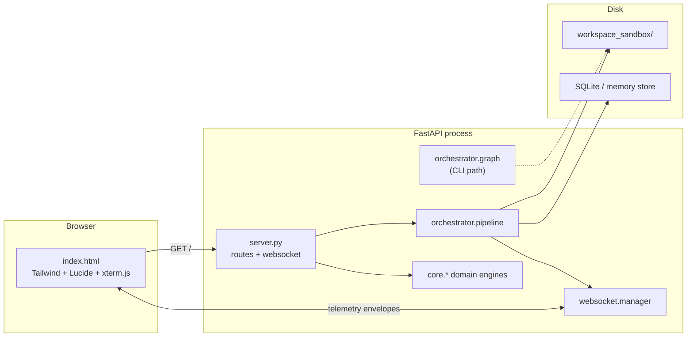
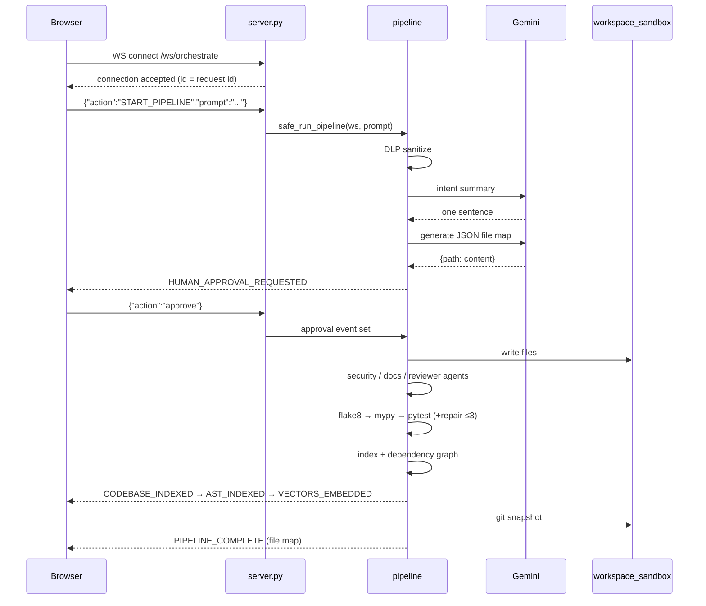

# Architecture

This document describes how Neural Glass is put together *today*. For
step-by-step internals see [TECHNICAL_DOCUMENTATION.md](TECHNICAL_DOCUMENTATION.md);
for the endpoint reference see [API_DOCUMENTATION.md](API_DOCUMENTATION.md).

---

## 1. Process model

One Python process serves both the dashboard and the orchestration pipeline.

There is no task queue and no external state store. A run is one coroutine chain
inside the process, and the WebSocket is the only transport for progress.

---

## 2. Layers

| Layer | Modules | Responsibility |
| --- | --- | --- |
| Presentation | `static/index.html`, `static/favicon.svg` | Render telemetry, collect input, HITL decisions |
| Transport | `server.py`, `websocket/manager.py` | HTTP routes, one WebSocket per tab, envelope fan-out |
| Orchestration | `orchestrator/pipeline.py`, `orchestrator/graph.py` | Sequence the stages, own the run lifecycle |
| Agents | `orchestrator/agents.py`, `planner.py`, `scaffolder.py`, `executor.py`, `validators.py` | Planning, generation, review, test nodes |
| Capabilities | `orchestrator/testers.py`, `repair.py`, `indexer.py`, `dep_graph.py`, `sandbox.py`, `git_agent.py` | Lint/type/test, repair, indexing, persistence, git |
| Model access | `llm/gemini.py`, `llm/retry.py` | Single provider, sync→async adapter, retries |
| Platform services | `core/*` | Config, logging, metrics, tracing, health, domain endpoints |
| Extensions | `plugins/` | Hooks invoked around generation/persistence |

Dependencies point **downward only**: presentation → transport → orchestration →
capabilities → platform. The one deliberate cycle is `pipeline` ↔ `server`, used
for the shared HITL event and state objects; it resolves because those names are
only touched at call time.

---

## 3. Run lifecycle

**Failure handling.** `run_educational_pipeline` wraps the body in a try/except,
emits `PIPELINE_ERROR` with the traceback, and `safe_run_pipeline` records the
failure in metrics without re-raising. The socket stays open for another run.

**HITL.** The gate uses an `asyncio.Event` plus two module-level objects on
`server`: the latest state and the current event. A decision can arrive over the
WebSocket (`approve`/`reject`) or via `POST /api/execution/{approve|reject}`.
Timeout is 300 seconds; rejection halts before persistence.

---

## 4. Frontend architecture

`static/index.html` is intentionally a single file with no build step:

* **Design system** — CSS custom properties for canvas, surfaces, hairlines,
  one mint accent, plus semantic warning/danger/violet tones.
* **State** — a handful of module-scope variables (`ws`, `generatedProjectFiles`,
  `conceptHistory`, `totalDlpBlocked`) and the xterm instance.
* **Transport** — one WebSocket with automatic reconnect; every inbound message
  goes through `handleTelemetryEvent`.
* **Presentation mapping** — backend node ids map to six visual stages
  (`NODE_TO_STAGE`); this is display-only and does not affect orchestration.
* **Accessibility** — tabs expose `role="tab"` + `aria-selected`, panes use the
  `hidden` attribute, dialogs declare `aria-modal`, icon-only buttons have labels.

---

## 5. Data ownership

| Data | Owner | Lifetime |
| --- | --- | --- |
| Requirement prompt | client + pipeline state | one run |
| Sanitized prompt | pipeline | one run |
| Generated files | `OrchestratorState["generated_files"]`, then disk | run + disk |
| FinOps ledger | `FinOpsTracker` instance | one run |
| Session memory | `core/memory.py` (SQLite) | persistent |
| Symbol/dependency index | `orchestrator/indexer.py`, `dep_graph.py` | process |
| Connection registry | `websocket/manager.py` | process |

---

## 6. Design constraints kept on purpose

* **Gemini-only.** No provider abstraction layer was added; the generator
  contract (raw JSON of file paths to contents) is part of the system's shape.
* **Sequential pipeline.** The web path does not use LangGraph's checkpointer;
  parallelism is limited to the agent mesh (`asyncio.gather`).
* **Single-file UI.** Easier to read for a teaching project; the trade-off is no
  component tooling.
* **Sample AST/vector payloads.** Deliberate teaching aids, flagged in code and
  documentation rather than presented as real analysis.
